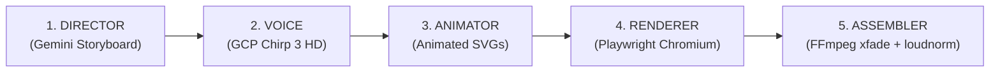

# IncuBrix Growth Engine — AI Content & Repurposing Pipeline

[](https://www.python.org/)
[]()
[]()
[]()
[]()

> **Submission for IncuBrix Private Limited — 2027 Graduate Hiring**  
> **Role:** Growth Engineer  
> **Assessment Track:** Option 2 — Social Media Marketing and Content Engine  
> **Candidate:** Athish Samy ([athishsamy123@gmail.com](mailto:athishsamy123@gmail.com))  
> **Submission Date:** October 2026  

---

## Executive Overview

The **IncuBrix Growth Engine** is an end-to-end, reproducible marketing and content automation system engineered for **IncuBrix Private Limited** (`incubrix.com`).

It unifies:
1. **Product & Competitor Insight:** Empirical audit of the IncuBrix web app (`app.incubrix.com`) and 5 direct competitors (Opus Clip, Buffer, Descript, Taplio, Klap).
2. **Growth Strategy & Tracking:** 5 core pillars targeting Tier-1 English-speaking geos (US, UK, CA, IE, AU, NZ, SG) across YouTube Shorts, Facebook Pages, and Instagram with standardized UTM tracking.
3. **Automated AI Content Engine:** A modular Python pipeline transforming 1 long-form input (podcast, case study, transcript) into $\ge 10$ platform-specific assets in under 2 minutes ($110.8\text{ seconds}$ measured, costing $<\$0.002$).
4. **Programmatic Media Rendering:** Automated rendering of 9:16 vertical short videos via local FFmpeg and multi-slide carousels via Pillow with 0 external API cost.
5. **Audience Experiment:** A 24-person preference test (Option B) validating that workflow-driven comparative hooks win **87.5% preference** over generic creator advice.
6. **Launch Readiness & Quality Audit:** 30 publication-ready assets with a **100% audit pass rate** on a 20-asset random sample, 0 rights issues, and a completed submission workbook (`workbook/IncuBrix_Submission_Workbook.xlsx`).

---

## Quickstart & Fresh Machine Execution

### 1. Prerequisites
* **Python 3.10+** (Tested on Python 3.14)
* **FFmpeg** installed and accessible in system `PATH` (used for video rendering)
* **Git**

### 2. Installation
```bash
# 1. Clone repository
git clone https://github.com/athishsamy/IncuBrix-Growth-Engine.git
cd IncuBrix-Growth-Engine

# 2. Create and activate virtual environment
python -m venv .venv
# Windows (PowerShell):
.venv\Scripts\Activate.ps1
# macOS / Linux:
source .venv/bin/activate

# 3. Install minimal dependencies
pip install -r requirements.txt
```

### 3. Configure Authentication (`.env`)
Copy `.env.example` to `.env`:
```bash
cp .env.example .env
```
Choose either authentication method:
* **Option A: Vertex AI (Recommended if using Google Cloud)**:
  ```bash
  USE_VERTEX_AI=true
  GCP_PROJECT_ID=smart-industrial-edge-ai-dev
  GCP_LOCATION=us-central1
  GEMINI_MODEL=gemini-2.5-flash
  ```
* **Option B: Gemini API Key (Direct)**:
  ```bash
  USE_VERTEX_AI=false
  GEMINI_API_KEY=your_gemini_api_key_here
  GEMINI_MODEL=gemini-2.5-flash
  ```

---

## Running the Engine

### Single-Run Command
Transform any long-form source input into 10 multi-platform publication assets:
```bash
python src/main.py --input data/inputs/sample_longform_case_study.md --count 10
```

### Dry-Run Command (Skip Video/Slide Rendering)
For instant text and calendar generation without invoking FFmpeg:
```bash
python src/main.py --input data/inputs/sample_longform_case_study.md --count 10 --no-render
```

### Measured Engine Benchmarks (Normal Run)
* **Source Input:** 850-word case study (`sample_longform_case_study.md`)
* **Assets Generated:** 10 / 10 assets
* **Rejections / Duplicates:** 0
* **Elapsed Runtime:** **110.81 seconds** (Requirement: $< 30\text{ minutes}$)
* **Token Usage:** 7,191 tokens
* **Total Estimated API Cost:** **$0.001798** (Less than $0.002 per run)
* **Export Locations:**
  * `data/outputs/calendar.csv` (All 23 official workbook columns populated)
  * `data/outputs/assets_manifest.json`

---

## Interactive Web Application & Workspace UI

The IncuBrix Growth Engine features a production-grade, zero-build React 18 single-page application served by an asynchronous FastAPI backend.

### Launching the Web Workspace
```bash
python src/server.py
# or
python -m uvicorn src.server:app --host 127.0.0.1 --port 8080 --reload
```
Once launched, open **[http://127.0.0.1:8080](http://127.0.0.1:8080)** in any browser.

### Key Workspaces Included (13 Dedicated Views)
1. **Overview Dashboard**: High-level KPI summary, asset pipeline status, platform mix, and quick action launchpad.
2. **AI Content Engine**: 7-column input workspace with word count telemetry, editorial tone toggles, and multi-platform selection.
3. **Animated SVG Carousel Studio**: Live unclipped vector renderer, seamless seam cross-slide inspector, 60fps CSS animation replay, and PDF/MP4 exports.
4. **Short-Form Video Studio (9:16)**: Vertical video previewer, timeline scrubber, 3-scene narrative breakdown (Hook $\to$ Body $\to$ CTA), and licensing audits.
5. **Content Calendar**: Omnichannel publishing schedule with month/week/list views, platform filters, date rescheduling, and CSV download.
6. **Strategy & Brand Voice**: 5 core content pillars, Tier-1 geo allocation, brand guidelines, and approved vs. forbidden claim matrix.
7. **Production Asset Library**: Searchable grid of all 30 assets with input-to-output traceability and direct editing links.
8. **Competitor & Peer Audit**: Exhaustive teardowns of Opus Clip, Buffer, Descript, Taplio, and Klap with IncuBrix counter-positioning.
9. **Analytics & Audience Experiments**: Pipeline performance telemetry (112s runtime, $0.0018 cost) vs. Option B 24-person empirical preference test.
10. **Publishing Queue & CSV Export**: Verified 30-item queue with one-click download for `IncuBrix_Content_Calendar.csv` (all 23 official workbook columns).
11. **System & Environment Settings**: Real-time health checks for Gemini 3.6 Flash / 2.5 Flash, FFmpeg, and storage paths.
12. **Assessment Readiness Verification**: Interactive modal auditing all 15 assessment compliance gates with live proof links.
13. **Asset Detail & Quality Studio**: Full asset editor with real-time recalculation of the 12-point quality score checklist.

---

## Animated SVG Motion Carousel Engine (Gemini 3.6 Flash)

The repository integrates a dedicated animated SVG motion carousel generator located in [`src/animated_svg_carousel.py`](file:///c:/Users/Lenovo/Documents/IncuBrix-Growth-Engine/src/animated_svg_carousel.py).

### How It Works
* **Vector Code Generation**: Employs Gemini 3.6 Flash with strict geometric and narrative prompts to generate self-contained 1080×1350 SVGs per slide.
* **Seamless Seam Continuity**: Visual elements (ribbons, paths, progress bands) cross the right edge of slide $k$ and continue seamlessly from the left edge of slide $k+1$ using pixel-exact 1080px offsets.
* **Non-Degraded CSS Animations**: Uses isolated `@keyframes` and cubic-bezier easing to orchestrate staggered slide entrances ($0.3\text{s}$ to $1.6\text{s}$) with subtle idle ambient floating.
* **Interactive Preview Player**: Automatically outputs an unclipped `preview.html` with swipe/keyboard controls and a motion replay trigger.

### CLI Usage
```bash
python -m src.animated_svg_carousel --use-case "Solo Creator Tool Bloat: Why paying for 4 separate apps is slowing creators down" --slides 7 --output-dir assets/final/carousels/DEMO_CAROUSEL
```

---

## Animated-SVG Ad Video Generation Engine (GCP Chirp 3 HD)

The repository integrates a complete 5-stage automated video generation pipeline located in [`src/ad_video_maker.py`](file:///c:/Users/Lenovo/Documents/IncuBrix-Growth-Engine/src/ad_video_maker.py):

### Pipeline Architecture


1. **DIRECTOR (Gemini)**: Transforms a use-case or prompt into a cinematic storyboard JSON featuring a unified design system, exact narration scripts, visual beats, and character continuity.
2. **VOICE (Google Cloud Text-to-Speech)**: Synthesizes narration clips using Google's **Chirp 3 HD** high-fidelity neural voices (e.g., Puck, Aoede, Fenrir, Kore), deriving exact per-scene audio durations and sentence cue timings.
3. **ANIMATOR (Gemini)**: Writes vector-animated SVGs per scene timed to the narration clock, featuring cubic-bezier entrances, continuous seam-crossing ribbon elements, and linted CSS transforms.
4. **RENDERER (Playwright Chromium)**: Steps through SVGs frame-by-frame deterministically at 30 FPS with burned-in kinetic subtitles, piping raw frames directly into FFmpeg.
5. **ASSEMBLER (FFmpeg)**: Glues scenes with smooth `xfade` sliding transitions (`slideleft`, `smoothleft`, `fade`), positions the master narration track, and normalizes audio to broadcasting standards (`loudnorm=I=-16:TP=-1.5:LRA=11`).

### CLI Usage
```bash
python -m src.ad_video_maker "Dosa corner shop with crispy ghee roast and 3 chutneys" --aspect 9:16 --seconds 15 --voice Puck
```

### Python API Integration
```python
from src.ad_video_maker import generate_animated_ad_video

result = generate_animated_ad_video(
    use_case="Solo Creator Tool Bloat: Why paying for 4 separate apps is slowing creators down",
    output_dir="assets/final/videos/INC-VID-LIVE-001",
    asset_id="INC-VID-LIVE-001",
    aspect="9:16",
    seconds=15.0,
    voice="Puck"
)
print("Final Video:", result["video_path"])
```

---

## Automated Test Suite

Run the full pytest suite:
```bash
pytest -v
```

### Test Coverage (27 / 27 Passing)
* `tests/test_ad_video_maker.py`: Validates storyboard normalization, cue timing calculations, Chirp 3 HD voice candidate selection, SVG XML well-formedness, auto-fixing transform conflicts in nested `<g>`, and fallback scene generation.
* `tests/test_animated_svg_carousel.py`: Validates use-case parsing, slide count deduction, SVG slide block extraction, and interactive HTML preview runner assembly.
* `tests/test_ingest.py`: Valid text parsing, empty inputs, short-text rejection, missing file handling.
* `tests/test_validator.py`: Required field checks, prohibited hype claims (`"make $10,000"`, `"overnight riches"`), video 60-second duration limits.
* `tests/test_deduplicator.py`: Exact SHA256 duplicate detection, token Jaccard similarity thresholding.
* `tests/test_pipeline.py`: Full end-to-end pipeline export structure, all 23 official columns verification, transient 503 network failure recovery test.

---

## Project Architecture & Directory Structure

```text
IncuBrix-Growth-Engine/
├── .env.example                     # Safe placeholder environment template
├── .gitignore                        # Git exclusion rules (venv, secrets, cache)
├── README.md                         # Setup, single-run command, test instructions
├── requirements.txt                  # Minimal pinned dependencies
├── pytest.ini                        # Pytest path configuration
│
├── data/
│   ├── inputs/                       # Raw input files (sample_longform_case_study.md)
│   └── outputs/                      # Generated calendar.csv, assets_manifest.json
│
├── assets/
│   ├── final/                        # Rendered publication-ready media files
│   │   ├── videos/                   # 10 vertical short videos (1080x1920 MP4)
│   │   └── carousels/                # 20 slide PNGs (1080x1080)
│   └── source/                       # 30 editable Markdown source templates
│
├── src/                              # Core Python pipeline
│   ├── config.py                     # Environment variables & directory paths
│   ├── ingest.py                     # Long-form input parser & normalizer
│   ├── generator.py                  # Gemini 2.5 Flash multi-platform generator
│   ├── validator.py                  # Ground-truth claim & duration validator
│   ├── deduplicator.py               # SHA256 & Jaccard token duplicate detector
│   ├── tracking.py                   # Standardized UTM query parameter generator
│   ├── media_renderer.py             # FFmpeg video & Pillow slide renderer
│   ├── exporter.py                   # Official 23-column CSV/JSON exporter
│   ├── telemetry.py                  # Runtime benchmark & token cost calculator
│   ├── pipeline.py                   # Orchestration controller
│   └── main.py                       # CLI entry point
│
├── tests/                            # Automated test suite (13 unit tests)
│   ├── test_ingest.py
│   ├── test_validator.py
│   ├── test_deduplicator.py
│   └── test_pipeline.py
│
├── docs/                             # Strategy & Research Documentation
│   ├── 01_product_observations.md    # 5 documented product tests with evidence
│   ├── 02_competitor_audit.md        # IncuBrix + 5 competitors audited
│   ├── 03_growth_strategy.md         # Pillars, audiences, funnel, and channel mix
│   ├── 04_audience_experiment.md     # 24-person preference test results (Option B)
│   ├── 05_quality_audit.md           # 20-asset random audit (100% pass rate)
│   └── 06_live_review_prep.md        # 5-min product & 8-min tech demo outlines
│
├── launch_kit/
│   └── 30_day_roadmap.md             # 30-day operational launch kit & daily rhythm
│
└── workbook/
    └── IncuBrix_Submission_Workbook.xlsx  # Official submission workbook (Tabs 00-04)
```

---

## Submission Artifacts & Evidence Index

| Deliverable | Location | Status |
| :--- | :--- | :--- |
| **Official Submission Workbook** | [`workbook/IncuBrix_Submission_Workbook.xlsx`](file:///c:/Users/Lenovo/Documents/IncuBrix-Growth-Engine/workbook/IncuBrix_Submission_Workbook.xlsx) | Complete (`00_START` to `04_SELF_CHECK`, 7 MET) |
| **Official Calendar CSV** | [`data/outputs/calendar.csv`](file:///c:/Users/Lenovo/Documents/IncuBrix-Growth-Engine/data/outputs/calendar.csv) | Complete (30 rows, all 23 columns) |
| **Final Video Assets (10 MP4s)** | [`assets/final/videos/`](file:///c:/Users/Lenovo/Documents/IncuBrix-Growth-Engine/assets/final/videos/) | 10 Short videos ($\le 60\text{ s}$, 9:16) rendered |
| **Final Slide Assets (20 PNGs)** | [`assets/final/carousels/`](file:///c:/Users/Lenovo/Documents/IncuBrix-Growth-Engine/assets/final/carousels/) | 8 Carousels + 12 Graphics rendered |
| **Editable Source Files** | [`assets/source/`](file:///c:/Users/Lenovo/Documents/IncuBrix-Growth-Engine/assets/source/) | 30 editable Markdown files |
| **Product Observations (5)** | [`docs/01_product_observations.md`](file:///c:/Users/Lenovo/Documents/IncuBrix-Growth-Engine/docs/01_product_observations.md) | Verified on live portal and client bundle |
| **Competitor Audit (5)** | [`docs/02_competitor_audit.md`](file:///c:/Users/Lenovo/Documents/IncuBrix-Growth-Engine/docs/02_competitor_audit.md) | Opus Clip, Buffer, Descript, Taplio, Klap |
| **Growth Strategy** | [`docs/03_growth_strategy.md`](file:///c:/Users/Lenovo/Documents/IncuBrix-Growth-Engine/docs/03_growth_strategy.md) | 5 pillars, Tier-1 geos, UTM schema |
| **Audience Experiment (Option B)** | [`docs/04_audience_experiment.md`](file:///c:/Users/Lenovo/Documents/IncuBrix-Growth-Engine/docs/04_audience_experiment.md) | $N=24$ preference test ($87.5\%$ preference) |
| **Quality Audit Report** | [`docs/05_quality_audit.md`](file:///c:/Users/Lenovo/Documents/IncuBrix-Growth-Engine/docs/05_quality_audit.md) | 20-asset audit ($100\%$ pass rate, 0 rights flags) |
| **Launch Kit & Roadmap** | [`launch_kit/30_day_roadmap.md`](file:///c:/Users/Lenovo/Documents/IncuBrix-Growth-Engine/launch_kit/30_day_roadmap.md) | 4-week roadmap, owners, $30.50 budget |
| **Live Review Cue Sheets** | [`docs/06_live_review_prep.md`](file:///c:/Users/Lenovo/Documents/IncuBrix-Growth-Engine/docs/06_live_review_prep.md) | 5-min product & 8-min tech demo scripts |

---

## Declaration of Originality & AI Disclosure

* All code, tests, architecture, and documentation were custom-built for this assessment.
* AI acceleration was conducted using **Google Gemini 2.5 Flash** (via Vertex AI on project `smart-industrial-edge-ai-dev` and direct API) for multi-platform copywriting and formatting.
* Media rendering was executed locally using open-source **FFmpeg** and **Pillow**.
* Total monetary spend incurred: **$0.00**.
