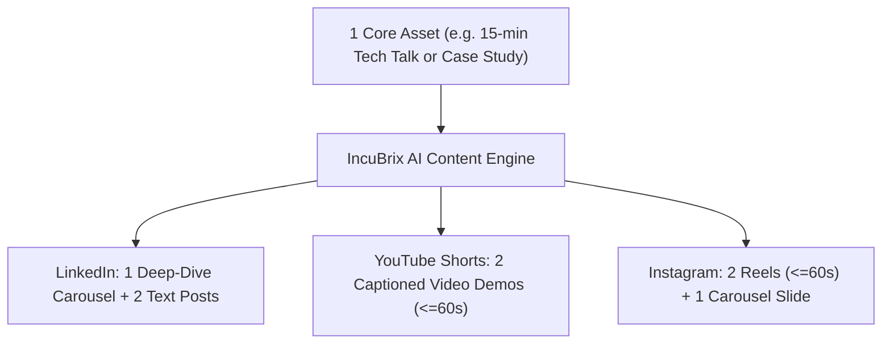
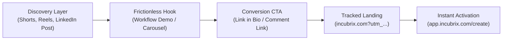

# IncuBrix Multi-Platform Growth Strategy & Operational Tracking Plan

**Document Version:** 1.0 (Baseline Strategy)  
**Author:** Senior Growth Engineer  
**Scope:** Organic Social Growth, Content Distribution Engine, Conversion Funnel, and UTM Architecture  
**Geographic Focus:** United States (US), Canada (CA), United Kingdom (UK), Ireland (IE), Australia (AU), New Zealand (NZ), Singapore (SG).

---

## 1. Target Audience Segments & Core Pain Points

```
+----------------------------------------------------------------------------------------------------+
|                                    AUDIENCE SEGMENTATION MATRIX                                    |
+---------------------+-------------------------------+----------------------------------------------+
| Segment             | Primary Motivation            | Core Pain Point Solved by IncuBrix           |
+---------------------+-------------------------------+----------------------------------------------+
| 1. Solo Creators &  | Maximizing reach per recorded | Spending 8+ hours editing clips and captioning|
|    Podcasters       | hour; eliminating burnout.    | across 4 different subscription tools.       |
|                     |                               |                                              |
| 2. B2B Growth       | Scaling inbound pipeline;     | High agency costs; slow turnaround for      |
|    Marketers        | establishing founder authority| thought leadership assets across LinkedIn.   |
|                     |                               |                                              |
| 3. Boutique Content | Increasing profit margins;    | Managing fragmented client approvals and     |
|    Agencies         | handling 5x more client seats.| disjointed file handoffs across tools.       |
+---------------------+-------------------------------+----------------------------------------------+
```

---

## 2. Platform Selection & Evidence-Based Rationale

We focus strictly on the top 3 high-leverage platforms that directly align with IncuBrix's verified product features (`/publishing/linkedin`, `/publishing/instagram`, `/publishing/youtube`):

| Platform | Primary Content Format | Audience Match | Strategic Rationale |
| :--- | :--- | :--- | :--- |
| **LinkedIn** | PDF Carousels, Text-Hook Posts, Video Clips | B2B Marketers, Growth Engineers, Agency Founders | Highest organic B2B reach; superior conversion rate to SaaS free trials; direct fit for tool-consolidation economics. |
| **YouTube Shorts** | 9:16 Vertical Videos ($\le 60\text{ s}$) | Video Creators, Podcasters, Educators | Algorithmic long-tail discovery; viewers seek video editing solutions on YouTube; high intent for AI workflow tutorials. |
| **Instagram** | Reels, Multi-Slide Graphics | Solo Creators, Lifestyle Entrepreneurs | High visual engagement; dynamic captioning showcases; strong direct message (DM) and link sticker conversion. |

---

## 3. The Five Core Content Pillars

* **Pillar 1: CreatorOps & Tool Consolidation (40% Weight)**
  * *Theme:* The engineering behind modern content creation; tearing down the "tool fatigue" trap ($100/mo across 4 apps).
  * *Formats:* Comparative carousels, workflow architecture teardowns, cost-benefit breakdown graphics.
* **Pillar 2: Repurposing Recipes (25% Weight)**
  * *Theme:* Practical step-by-step transformations: turning 1 podcast, webinar, or blog into 10 platform-specific assets in under 30 minutes.
  * *Formats:* Fast-paced split-screen screen recordings, before/after videos.
* **Pillar 3: AI Video & Voice Engineering (15% Weight)**
  * *Theme:* Prompt-based video editing, synthetic audio dubbing, and voice cloning (`/voice-hub`).
  * *Formats:* Product feature demos, audio comparison clips, technical teardowns.
* **Pillar 4: Growth Analytics & Algorithm Benchmarks (10% Weight)**
  * *Theme:* Empirical social media benchmarks: hook retention curves, repurposing decay rates, Creator Growth Score.
  * *Formats:* Data visualization infographics, metric checklists.
* **Pillar 5: Behind-the-Studio & Product Spotlights (10% Weight)**
  * *Theme:* Direct product tours of `/thought-inbox`, `/editor`, and collaborative client approval workflows.
  * *Formats:* Quick-draft walkthroughs, UI micro-tours.

---

## 4. Brand Voice, Terminology & Prohibited Claims

### Brand Voice Principles
* **Engineering-Grounded:** Speak with technical precision (focus on workflows, pipeline throughput, latency, and ROI).
* **Empathetic & Pragmatic:** Acknowledge creator exhaustion without resorting to toxic hustle culture.
* **Zero Fluff:** Provide actionable frameworks in the first 3 seconds of video or first line of text.

### Approved Terminology
* *CreatorOps, Single-Input Multi-Format Pipeline, Prompt-Based Video Editing, Voice Hub, Omnichannel Distribution, Unified Workspace.*

### Strictly Prohibited Claims (Integrity Rules)
* **Never** promise guaranteed follower numbers, revenue, or "instant viral fame" (e.g., "Get 100k followers in 7 days").
* **Never** use fabricated user testimonials or fake metric screenshots.
* **Never** claim features that are not verified in the codebase (e.g., automated mind-reading or fake integrations).

---

## 5. Publishing Cadence & Repurposing Architecture



### Weekly Publishing Cadence (Small-Team Baseline)
* **LinkedIn:** 4 posts/week (2 carousels, 2 punchy text/image breakdowns).
* **YouTube Shorts:** 3 videos/week (30–60 second screen captures / tutorials).
* **Instagram:** 4 posts/week (2 Reels synced with Shorts, 2 educational carousels).
* **Total Assets per Month:** $\approx 44$ assets (comfortably exceeds the 30-asset baseline).

---

## 6. Conversion Funnel & UTM Tracking Architecture



### Standardized UTM Parameter Convention

All links across every asset adhere strictly to this schema:
`https://incubrix.com/?utm_source={platform}&utm_medium={format}&utm_campaign=growth_engine_q1&utm_content={asset_id}&utm_term={content_pillar}`

* **`utm_source`**: `linkedin`, `instagram`, `youtube`
* **`utm_medium`**: `carousel`, `short_video`, `text_post`, `graphic`
* **`utm_campaign`**: `growth_engine_q1`
* **`utm_content`**: Unique Asset ID (e.g. `INC-LI-001`, `INC-YT-004`)
* **`utm_term`**: Pillar slug (e.g. `creator_ops`, `repurposing_recipes`, `voice_engineering`)

---

## 7. Baseline Targets & Measurement Limitations

| Platform | Primary Target Metric | 30-Day Baseline Target | Measurement Limitation & Verification Method |
| :--- | :--- | :--- | :--- |
| **LinkedIn** | Impressions & Engagement Rate | 1,500 impressions/post; $\ge 2.5\%$ ER | Measured via native post analytics; public view reflects reactions/comments only. |
| **YouTube Shorts**| View-Through Rate (VTR) | $\ge 40\%$ retention at 30 seconds; 1k views | Shorts feed algorithm features high early variance; verified in YouTube Studio. |
| **Instagram** | Saves & Profile Visits | $\ge 4.0\%$ save rate; 50 visits/week | Private insights required for exact saves; verified via creator dashboard. |
| **Conversion** | Tracked UTM Clicks | $\ge 250$ verified clicks; $\ge 12\%$ trial sign-up | Tracked via GA4 / server-side analytics from UTM parameters. |
