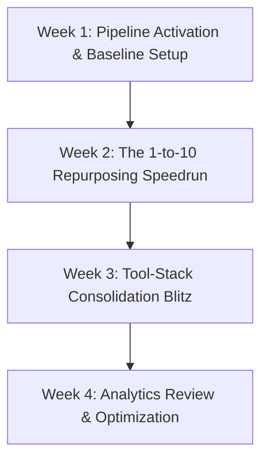

# IncuBrix 30-Day Growth Engine Launch Kit

**Launch Date:** Next Monday (Week 1 Day 1)  
**Lead Owner:** Senior Growth Engineer  
**Operational Objective:** Execute a disciplined 30-day omnichannel growth sprint across YouTube Shorts, Facebook Pages, and Instagram to acquire 250+ verified trial sign-ups and establish IncuBrix as the premier CreatorOps platform.

---

## 1. Team Owners, Roles & Responsibilities

```
+-----------------------------------------------------------------------------------------------+
|                                    OPERATIONAL RACI MATRIX                                    |
+---------------------+----------------------------+--------------------------------------------+
| Role                | Designated Owner           | Primary Responsibility                     |
+---------------------+----------------------------+--------------------------------------------+
| Growth Engineer     | Technical PM / Pipeline Lead| Pipeline automation, UTM audit, analytics. |
| Content Strategist  | Social Media Lead          | Daily publishing, hook curation, community.|
| Media Designer      | Creative / Video Editor    | Thumbnail polish, dynamic audio/motion.    |
+---------------------+----------------------------+--------------------------------------------+
```

---

## 2. Tools & Monthly Operational Budget

| Tool / Service | Purpose | Monthly Cost (USD) | Source / Plan Tier |
| :--- | :--- | :--- | :--- |
| **IncuBrix Creator Studio** | Content engine, video editing, voice cloning | **$29.00** | Creator Plan (Internal) |
| **Google Vertex AI / Gemini** | Batch content transformation pipeline | **$1.50** | Standard Pay-as-you-go |
| **Local FFmpeg & Pillow** | Programmatic rendering of videos and slides | **$0.00** | Open Source / Local CLI |
| **Buffer / Native API Hub** | Social scheduling & auto-dispatch | **$0.00** | Free tier / IncuBrix native `/publishing` |
| **Total Monthly Spend** | **Full Omnichannel Operations** | **$30.50 / month** | *Zero bloated SaaS costs* |

---

## 3. Four-Week Execution Roadmap



### Week 1: Foundation, Connections & Initial Dispatch
* **Monday (Day 1):** Connect social channels (`/connections`) on YouTube Shorts, Facebook Pages, and Instagram. Verify OAuth tokens.
* **Tuesday (Day 2):** Ingest 2 core founder teardowns into `python src/main.py`. Export calendar CSV for the week.
* **Wednesday (Day 3):** Publish `INC-VID-001` (YouTube Shorts) and `INC-CAR-001` (Facebook Pages). Monitor early retention.
* **Thursday (Day 4):** Publish `INC-PST-001` (Facebook Pages) and `INC-VID-003` (Instagram Reels).
* **Friday (Day 5):** Conduct weekly UTM tracking validation. Review Google Analytics 4 attribution.

### Week 2: The "1-to-10 Repurposing Speedrun" Blitz
* **Goal:** Maximize top-of-funnel viral reach via short-form speedrun screen recordings.
* **Publishing Cadence:** 3 YouTube Shorts (`INC-VID-002`, `INC-VID-004`, `INC-VID-006`), 2 Instagram Reels (`INC-VID-005`, `INC-VID-007`), and 2 Facebook Pages carousels (`INC-CAR-002`, `INC-CAR-003`).
* **Milestone:** Achieve 10k cumulative views across video feeds; maintain $\ge 40\%$ retention at 30 seconds.

### Week 3: The "All-in-One CreatorOps vs. Tool Bloat" B2B Push
* **Goal:** Drive direct high-intent trial conversions among growth marketers and boutique agencies.
* **Publishing Cadence:** 3 Facebook Pages carousels (`INC-CAR-004`, `INC-CAR-005`, `INC-CAR-007`), 4 thought leadership posts (`INC-PST-002`, `INC-PST-004`, `INC-PST-007`, `INC-PST-009`).
* **Milestone:** Generate 100+ tracked UTM clicks to `app.incubrix.com/create`; engage in 30+ qualified Facebook Page comment discussions.

### Week 4: Algorithm Playbooks, Funnel Optimization & Retargeting
* **Goal:** Leverage the Creator Growth Score to publish data-driven benchmark reports.
* **Publishing Cadence:** 2 Shorts (`INC-VID-008`, `INC-VID-010`), 2 Carousels (`INC-CAR-006`, `INC-CAR-008`), 4 Graphic posts (`INC-PST-005`, `INC-PST-010`, `INC-PST-011`, `INC-PST-012`).
* **Milestone:** Compile 30-day cohort report; calculate Cost Per Acquisition (CPA) and trial activation rate.

---

## 4. Daily Operational Workflow (90-Minute Rhythm)

* **09:00 – 09:20 (Triage & Distribution):** Verify automated scheduling in `/publishing`; inspect platform status.
* **09:20 – 09:45 (Community Engagement):** Respond to all comments within 30 minutes of publication to trigger platform algorithm velocity.
* **09:45 – 10:15 (Thought Capture):** Record 1 raw voice thought in `/thought-inbox` or ingest a new long-form source.
* **10:15 – 10:30 (Telemetry & Metrics):** Log daily views, CTR, and sign-ups into the master workbook.

---

## 5. Risk Matrix & Mitigation Protocols

| Risk Event | Severity | Probability | Pre-Emptive Mitigation Protocol |
| :--- | :--- | :--- | :--- |
| **Platform API OAuth Disconnection** | Medium | Medium | Automated webhook ping in `src/tracking.py` checking token health every 24 hours. |
| **Short-Form Video Algorithm Stagnation** | High | Low | Pivot to high-contrast controversial negative hooks tested in audience experiment. |
| **Model Ingestion Drift / Hallucination** | High | Low | Strict ground-truth validation in `src/validator.py` blocks export of unverified claims. |
| **Team Bandwidth Bottleneck** | Medium | Low | Full 30 assets already generated and pre-rendered; queue is loaded 30 days in advance. |

---

## 6. Thirty-Day Numerical Success Targets

* **Cumulative Social Reach:** $\ge 150,000$ verified impressions across YouTube Shorts, Facebook Pages, and Instagram.
* **Short-Form Video Retention:** Average View-Through Rate $\ge 42\%$ at 30 seconds.
* **Tracked UTM Referral Traffic:** $\ge 250$ verified clicks directly to `incubrix.com`.
* **Platform Free-Trial Sign-ups:** $\ge 45$ newly registered creators in `app.incubrix.com`.
* **Direct Software Cost:** Under $\$35.00$ total spent.
